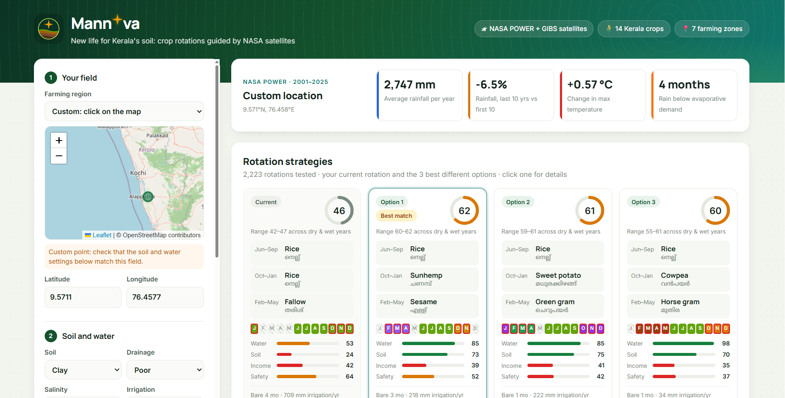
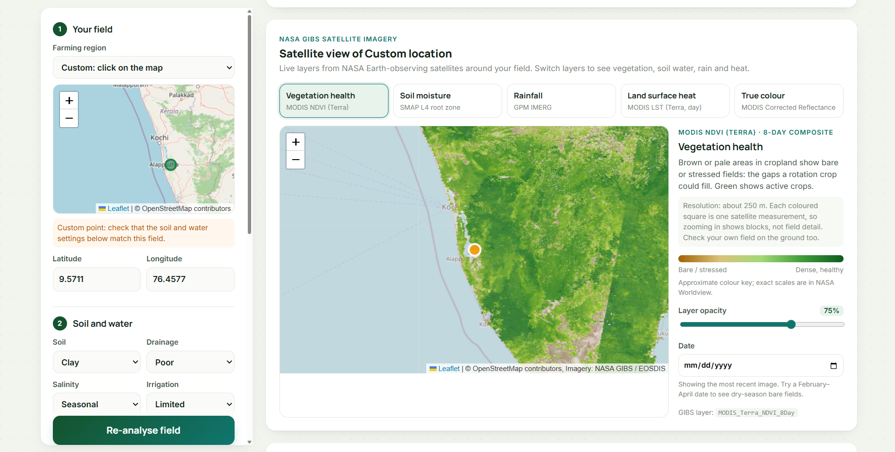

<p align="center">
  
</p>

<p align="center"><b>New Life for Kerala's soil: crop rotations guided by NASA satellites</b></p>

<p align="center">
  <a href="https://mannova.vercel.app"><b>Live app: mannova.vercel.app</b></a>
</p>

---

**NASA Space Apps Challenge 2026** · Challenge: **Field Shift – Adapting Farms with NASA Data** · Local event: Kanjirapally, Kerala, India

**Team:** Bazil Mathew P Sajan, Aron Koshy, Blesji K Abraham, Ashwel Rinu Oommen

*Mannova* = *Mannu* (മണ്ണ്, Malayalam for "soil") + *nova* (Latin for "new").



## The problem

Kerala's farms are under pressure. For a Kuttanad paddy field near Alappuzha, NASA POWER records show about 2,747 mm of rain a year, but 6.5% less in the last decade than in the first, maximum temperatures 0.57 °C higher than in 2001, and 4 months a year when rain falls short of evaporative demand. Many fields sit bare for months or stay locked into rice after rice, which drains the soil.

## What Mannova does

1. **Pick your field** on the map, or one of 7 Kerala farming zones (Kuttanad, Palakkad, Onattukara, Kole, midland laterite, Wayanad, northern coast).
2. **Describe it:** soil, drainage, salinity, irrigation and what you grow now.
3. **Set your priorities:** saving water, soil health, income, avoiding climate risk, better soil yeild.
4. Mannova pulls **25 years of NASA climate data** for that exact point and tests about **2,000 three-season rotations** of 14 Kerala crops against dry years, wet-year waterlogging, heat, salinity and evaporative demand.
5. It compares **your current rotation with the 3 best alternatives**, with crop names in Malayalam. For each strategy it shows:
   - a 12-month field calendar highlighting bare months and vulnerable seasons
   - why it was suggested, the NASA evidence, the benefits, the information gaps, and what to check locally
   - a score range across drier/hotter and wetter years (uncertainty)
6. **NASA satellite layers** around the field: MODIS vegetation health, SMAP soil moisture, GPM IMERG rainfall, MODIS land surface heat and true colour.
7. **What-if sliders** test less rain or more warming, and a glossary explains terms like evapotranspiration, water balance and NDVI in plain language.

Mannova **supports, never replaces**, farmers' judgement and advice from Krishi Bhavan officers.



## NASA data used

| Source | What | How Mannova uses it |
|---|---|---|
| **NASA POWER** (Agroclimatology, monthly point API) | T2M, T2M_MAX, T2M_MIN, PRECTOTCORR, RH2M, GWETROOT, 2001–2025 | Climate profile, 1-in-5 dry / 1-in-10 wet years, trends, water balance, crop scoring |
| **NASA GIBS** (WMS) | MODIS NDVI, SMAP L4 soil moisture, GPM IMERG precipitation, MODIS LST, MODIS true colour | Live satellite layers around the field |

Reference evapotranspiration (ET₀) is estimated with the Hargreaves method (FAO-56) from NASA POWER temperatures.

## Tech

Next.js 15, React, TypeScript, Recharts, Leaflet + OpenStreetMap, deployed on Vercel. The app lives in the [`field-shift/`](field-shift/) folder.

```bash
cd field-shift
npm install
npm run dev
# open http://localhost:3000
```

Key files: `lib/power.ts` (NASA POWER client), `lib/climate.ts` (climate profile, ET₀), `lib/rotation.ts` (scoring engine), `lib/crops.ts` (crop table), `lib/regions.ts` (Kerala zones), `lib/gibs.ts` and `app/api/gibs` (satellite layers).

## Limitations

- NASA POWER is a ~50 km grid, so it can't see a field's microclimate, canal water or bund height.
- Crop parameters are indicative values for Kerala; verify them with the Kerala Agricultural University Package of Practices.
- Soil type, drainage and salinity come from the farmer's inputs, not a soil test.
- There is no local market price data yet.

## References

- NASA POWER: https://power.larc.nasa.gov
- NASA GIBS: https://gibs.earthdata.nasa.gov
- FAO Irrigation and Drainage Paper 56 (crop evapotranspiration)
- Kerala Agricultural University, Package of Practices (crop reference)
- OpenStreetMap, Leaflet, Recharts, Next.js (open-source libraries)

## Use of AI (Space Apps SI disclosure)

This project was built with help from AI tools:
- **Anthropic's Claude**: helped write and refactor the application code (NASA data processing, rotation scoring engine, interface), this README and create the Mannova logo.
- **Canva AI**: Generated the slide layout and stock imagery in the demo deck.

Our team chose the challenge, region and approach, made the design decisions, tested the app with live NASA data, verified the results and deployed it.
